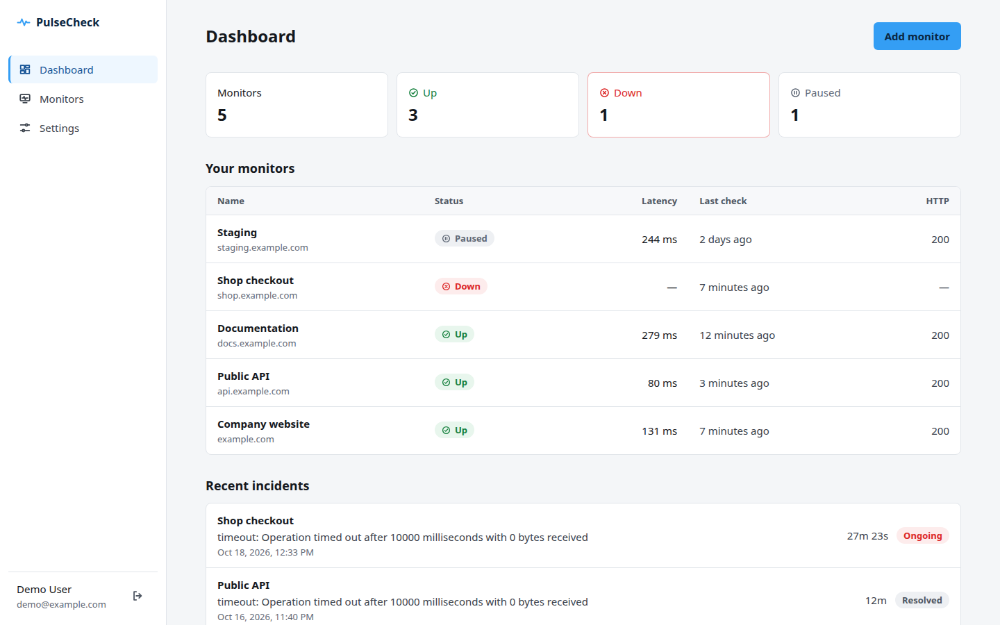
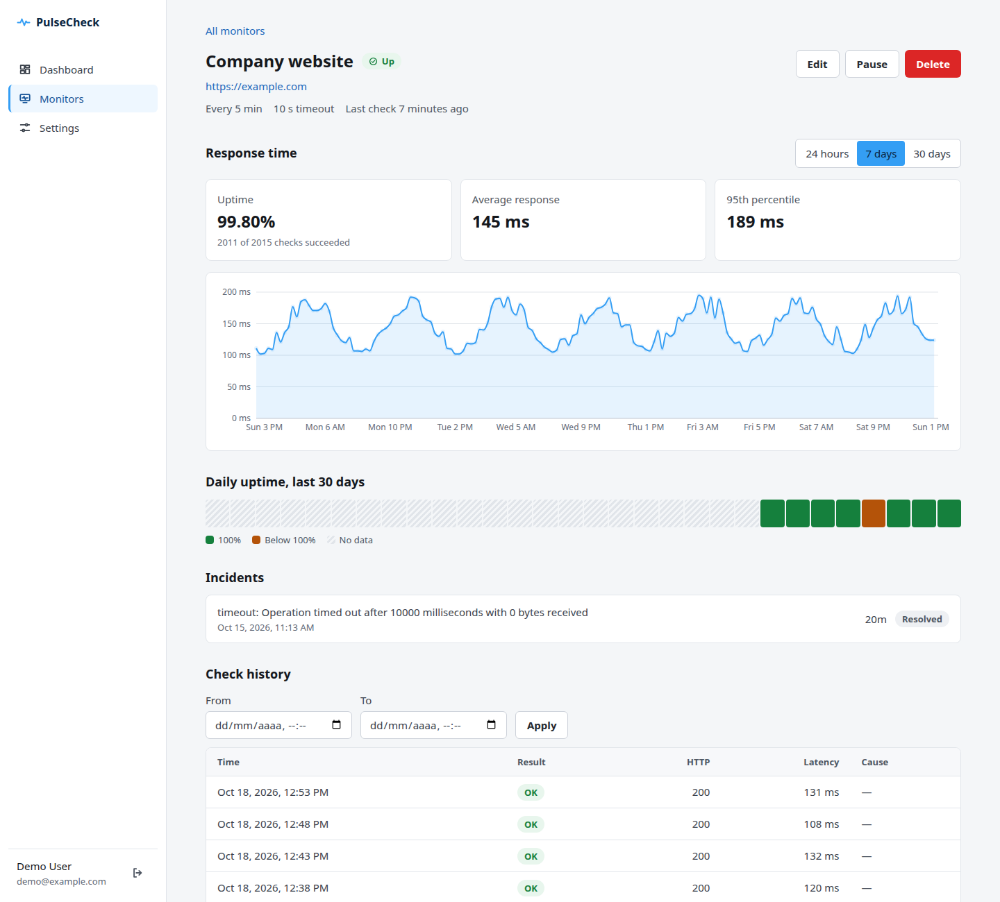
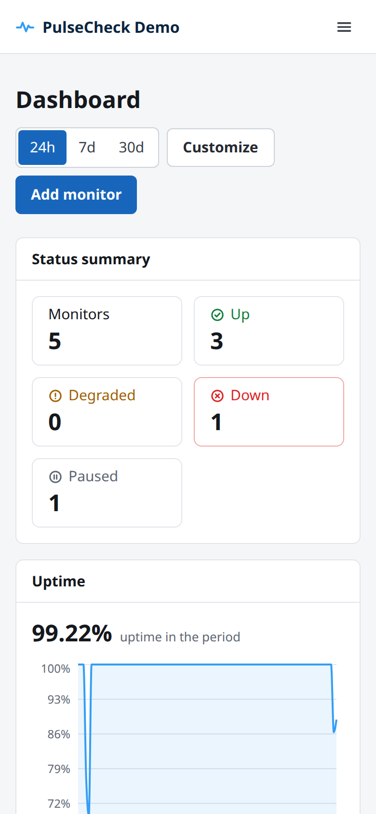
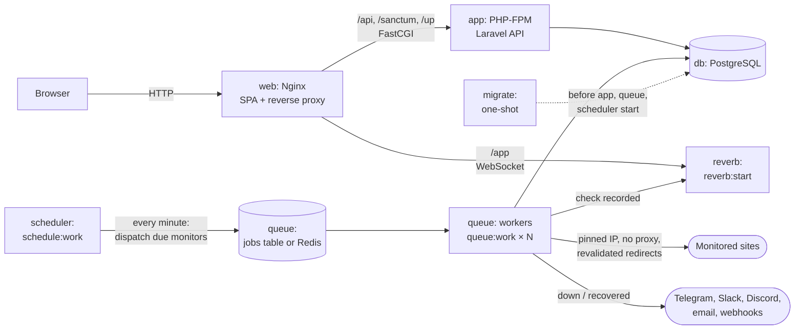

# PulseCheck

Self-hosted uptime monitoring for one team or organization per deploy: PulseCheck checks your websites and APIs every few minutes, records response times and incidents, and alerts you on Telegram, Slack, Discord, email or any webhook when something goes down and when it comes back.



<sub>Screenshots show the real application running locally with demo data from `DevelopmentSeeder`.</sub>

## Features

- **HTTP(S) monitors** checked every 1, 5 or 10 minutes with a configurable timeout (1–30 s). Each monitor can set the method, expected status codes (codes or ranges such as `200-299, 301`), whether redirects are followed, custom headers, a request body and basic or bearer authentication. Headers, body and credentials are stored encrypted and never shown again.
- **Other monitor types**:
  - **Keyword**: an HTTP(S) check that also requires the response body (first 1 MB) to contain, or not contain, a word.
  - **TCP port**: checks that a host and port accept a connection, for example a database or mail server.
  - **SSL certificate**: reads the HTTPS certificate, becomes `degraded` when it expires within the warning window (14 days by default) and goes `down` when it is expired or invalid.
  - **Heartbeat**: for cron jobs and other scheduled work. The job calls a secret URL (`GET`, `POST` or `HEAD /api/heartbeat/{token}`) on every run, and the monitor goes `down` when no call arrives within the interval plus a grace period. Intervals go up to 24 hours (`PULSECHECK_HEARTBEAT_INTERVALS`). The URL is shown only to people who can edit the monitor and can be regenerated.
- **Degraded status**: with a slow response limit set, responses slower than the limit mark the monitor `degraded` after 2 consecutive slow checks (`PULSECHECK_DEGRADED_TO_CONFIRM`). Degraded checks still count as available in uptime; the degradation gets its own incident and alerts.
- **Stable status**: a monitor goes `down` after 2 consecutive failures and back `up` after 2 consecutive successes, so a single blip does not raise an alert. A result that contradicts the current status is confirmed after half the check interval (at least 1 minute) instead of a full one.
- **Incidents** with cause, start, end and duration; one incident per outage. Anyone who can see the monitor can **acknowledge** an open incident and add **notes**; both update live for everyone looking at it.
- **Repeated alerts**: each monitor can repeat the down alert every 15, 30, 60, 120 or 240 minutes (`PULSECHECK_REMINDER_INTERVALS`) until the incident is acknowledged or resolved.
- **Maintenance windows**: one-off or weekly (with time zone, and windows that cross midnight), for chosen monitors or whole teams. During a window checks keep running, but no incident or alert is created and uptime leaves the period out. A failure that continues after the window opens the incident from the first check after it.
- **Metrics**: uptime per period (24 h, 7 d, 30 d), average and 95th percentile response time, latency chart and a 30-day availability bar that tells "no data" apart from "100%".
- **Check history** with date filters and pagination.
- **Notification channels** on down and recovery: Telegram, Slack, Discord, email and a generic JSON webhook for anything else. Each monitor picks its channels; every channel has a test button, and secrets (tokens, webhook URLs, headers) are stored encrypted and never shown again.
- **One instance per organization**: the first visit opens a setup wizard (instance name, time zone, language and the first administrator). Monitors and notification channels belong to teams, and each person sees only the teams they were given.
- **Teams, users and roles**: administrators create teams and accounts, and pick each person's role (`admin`, `manager` or `member`) and teams, or give them access to all monitors. Managers create and edit the monitors and channels of their teams; members only view them. There is no public sign-up. Login and password reset for everyone.
- **SSRF protection**: monitors cannot reach private networks, cloud metadata endpoints or other internal addresses, including through redirects or DNS tricks.
- **Single `docker compose up`** on any Linux server; Redis is optional.

| Monitor detail | Mobile |
|---|---|
|  |  |

More screenshots: [login](screenshots/login.png), [settings](screenshots/settings.png).

## Architecture



| Service | Responsibility |
|---|---|
| `web` | Nginx: serves the React build, proxies `/api`, `/sanctum` and `/up` to PHP-FPM and `/app` (WebSocket) to Reverb, adds security headers. The only published port. |
| `app` | PHP-FPM running the Laravel API (authentication, monitors, metrics, settings). |
| `queue` | Workers (`QUEUE_WORKERS`, default 2) that run checks and send notifications. |
| `reverb` | Laravel Reverb WebSocket server. Pushes every recorded check to the browsers of signed-in users, so the dashboard, the monitor list and the monitor page update immediately (they still poll as a fallback). |
| `scheduler` | Runs `monitors:dispatch-due` every minute and prunes old check results daily. |
| `migrate` | Applies database migrations once, before the other PHP services start. |
| `db` | PostgreSQL 17. Not reachable from outside the Compose network. |
| `redis` | Optional (profile `redis`): queues, cache and sessions. |

**Life of a check**

1. Every minute the scheduler selects active monitors whose `next_check_at` has passed, moves `next_check_at` forward by the monitor's interval and queues one `RunMonitorCheck` job each (jobs are unique per monitor).
2. A worker validates the URL again, resolves the host, rejects forbidden addresses and connects to the validated IP (`CURLOPT_RESOLVE`), following redirects manually and revalidating every hop, within the monitor's total timeout.
3. In one database transaction with the monitor row locked, the result is stored and the state machine updates counters and status, opening or resolving an incident when the threshold is crossed.
4. After the transaction commits, a down or recovery event queues one notification per enabled channel attached to the monitor, and the updated monitor is broadcast on the private `monitors` channel, which every signed-in user can join. A broadcast failure is logged and never discards the check.

## Tech stack

| Area | Technology |
|---|---|
| Backend | PHP 8.3, Laravel 13.37, Laravel Sanctum 4.3 (SPA cookie auth), Guzzle 8.2 |
| Database | PostgreSQL 17 |
| Queue / cache | Laravel database drivers by default; Redis 7 (phpredis) optional |
| Frontend | React 19.3, TypeScript 6.0, Vite 8.3, React Router 8.4, TanStack Query 5, Tailwind CSS 4.3, Recharts 3.10, axios 1.20 |
| Tests and quality | PHPUnit 12.5, Laravel Pint 1.32, Vitest 5.0, Testing Library, oxlint 1.88 |
| Runtime | Docker Compose: Nginx 1.30, PHP-FPM 8.3 (Alpine), Node 24 LTS for the build |

## Quick start (Docker Compose)

Requirements: a Linux server with Docker Engine and the Compose plugin. No PHP, Node or database is needed on the host.

```sh
git clone <repository-url> pulsecheck && cd pulsecheck
cp .env.example .env
```

Edit `.env` and set the three required values: `APP_KEY` (see [Generating `APP_KEY`](#generating-app_key)), `APP_URL` and `DB_PASSWORD` (for example `openssl rand -hex 24`). Then:

```sh
docker compose config -q     # validates the file and fails if a required variable is missing
docker compose up -d --build
docker compose ps -a         # app and web "healthy", migrate "Exited (0)"
curl -fsS http://localhost/up
```

Open `APP_URL` in a browser: the setup wizard asks for the instance name, time zone, language and the administrator account, and lets you add a first notification channel. Then add a monitor and create teams and accounts under **Settings → Teams** and **Settings → Users**. The first check runs within a minute; after two successful checks the monitor shows **Up**.

PulseCheck serves plain HTTP on `APP_PORT`. For HTTPS, put it behind a TLS-terminating proxy (Caddy, Traefik, your provider's proxy), then set `APP_URL` to the `https://` address, `SESSION_SECURE_COOKIE=true` and `TRUSTED_PROXIES` (see the table below). Until setup is done, the wizard asks for a setup token so that nobody else can claim the instance: Docker Compose generates one and prints it in the app logs (`docker compose logs app | grep "Setup token"`, or `docker compose exec app php artisan pulsecheck:setup-token`). To choose the token yourself, set `PULSECHECK_SETUP_TOKEN`.

### Environment variables

All variables live in the `.env` file next to `docker-compose.yml` (template: [`.env.example`](.env.example)).

| Variable | Required | Default | Description |
|---|---|---|---|
| `APP_KEY` | **yes** | — | Encryption key for sessions and the stored notification channel secrets. Keep it secret and do not change it: stored secrets become unreadable. |
| `APP_URL` | **yes** | — | Public address without trailing slash, e.g. `https://status.example.com`. Used for links in emails and to accept the SPA's session cookies. |
| `DB_PASSWORD` | **yes** | — | PostgreSQL password, used by both the database and the application. |
| `APP_PORT` | no | `80` | Host port published by the `web` container. |
| `SESSION_SECURE_COOKIE` | no | `false` | Set to `true` when served over HTTPS. |
| `TRUSTED_PROXIES` | no | empty | Reverse proxies allowed to set `X-Forwarded-*`: comma-separated IPs/CIDRs (e.g. `172.16.0.0/12`). Needed behind a proxy for correct client IPs (rate limits) and HTTPS detection. Avoid `*`: clients could then fake their IP and bypass rate limits. |
| `DB_DATABASE` / `DB_USERNAME` | no | `pulsecheck` | Database name and user. |
| `QUEUE_WORKERS` | no | `2` | Number of queue worker containers. Each check holds a worker for up to its timeout, so add workers as you add monitors (roughly one per 30 monitors at a 1-minute interval). Alerts use a separate `notifications` queue that workers always serve first. |
| `LOG_LEVEL` | no | `info` | Laravel log level; logs go to the container output. |
| `QUEUE_CONNECTION` / `CACHE_STORE` / `SESSION_DRIVER` | no | `database` | Set all three to `redis` to use Redis (see below). |
| `REDIS_PASSWORD` | only with Redis | empty | Password required by the `redis` service. |
| `REVERB_APP_KEY` / `REVERB_APP_SECRET` | no | `pulsecheck` / derived from `APP_KEY` | Credentials shared by the API and the `reverb` service. The key is public (sent to the browser); the secret signs channel subscriptions. |
| `MAIL_MAILER` | no | `log` | `smtp` to send password reset emails. With `log`, emails (including reset links, which are valid for 60 minutes) are written to the container logs: anyone who can read the logs could use them. Configure SMTP in production. |
| `MAIL_SCHEME`, `MAIL_HOST`, `MAIL_PORT`, `MAIL_USERNAME`, `MAIL_PASSWORD` | with SMTP | empty, `587` | SMTP connection (`MAIL_SCHEME=smtps` for port 465). |
| `MAIL_FROM_ADDRESS` / `MAIL_FROM_NAME` | no | `no-reply@example.com` / `PulseCheck` | Sender of password reset emails. |
| `PULSECHECK_SETUP_TOKEN` | no | empty | Token the first-run setup requires. When empty, one is generated and printed in the app logs. |
| `PULSECHECK_GENERATE_SETUP_TOKEN` | no | `true` | Generate a setup token when `PULSECHECK_SETUP_TOKEN` is empty. Set to `false` only on a private network. |
| `PULSECHECK_HISTORY_RETENTION_DAYS` | no | `30` | Check results older than this are deleted daily. Incidents are kept. |
| `PULSECHECK_UPTIME_ROLLUP_RETENTION_DAYS` | no | `400` | Daily uptime totals older than this are deleted. They keep the daily uptime bar filled after check results are deleted. |
| `PULSECHECK_ALLOW_PRIVATE_TARGETS` | no | `false` | Allow private/internal targets. Read [Security](#security) first. |
| `APP_IMAGE` / `WEB_IMAGE` | no | `pulsecheck-app:latest` / `pulsecheck-web:latest` | Image names; point them to prebuilt images to skip local builds. |

### Generating `APP_KEY`

Either of these prints a valid key; paste the whole value, including `base64:`, into `.env`:

```sh
echo "base64:$(openssl rand -base64 32)"
```

```sh
docker compose build app
docker run --rm pulsecheck-app:latest php artisan key:generate --show
```

### Optional Redis

The default `database` drivers are enough for a personal or small-team installation. Consider Redis when you run many monitors at a 1-minute interval or several queue workers: workers then wait on Redis instead of polling the `jobs` table, and unique-job locks and cache hits stop touching PostgreSQL.

1. Drain pending jobs so none are left behind in the `jobs` table:
   ```sh
   docker compose exec app php artisan queue:work --queue=notifications,default --stop-when-empty
   ```
2. In `.env`, set `REDIS_PASSWORD` (for example `openssl rand -hex 24`) and change `QUEUE_CONNECTION`, `CACHE_STORE` and `SESSION_DRIVER` to `redis`.
3. Start with the profile:
   ```sh
   docker compose --profile redis up -d
   ```

Sessions are not migrated, so everyone logs in again. Redis has no published port, requires the password and persists to the `redisdata` volume (append-only file). If a driver is set to `redis` while Redis is not running, the PHP containers refuse to start and print how to fix it. To go back, drain the Redis queue the same way, set the drivers to `database`, run `docker compose up -d` and stop Redis with `docker compose --profile redis stop redis`.

### Updating without data loss

```sh
docker compose exec -T db pg_dump -U pulsecheck -d pulsecheck -Fc > pulsecheck-before-update.dump
git pull
docker compose up -d --build
```

The `migrate` service applies new migrations before `app`, `queue` and `scheduler` start again. Data lives in the `pgdata` volume, so `docker compose down` and `up` keep it; only `docker compose down -v` deletes it.

### Backup and restore

Back up to a compressed custom-format dump:

```sh
docker compose exec -T db pg_dump -U pulsecheck -d pulsecheck -Fc > pulsecheck.dump
```

Restore it (stop the services that write to the database first):

```sh
docker compose stop app queue scheduler
docker compose exec -T db pg_restore -U pulsecheck -d pulsecheck --clean --if-exists < pulsecheck.dump
docker compose start app queue scheduler
```

Daily backup at 03:30 with cron (`crontab -e`, adjust the path; `%` must be escaped in crontab):

```cron
30 3 * * * cd /opt/pulsecheck && mkdir -p backups && docker compose exec -T db pg_dump -U pulsecheck -d pulsecheck -Fc > backups/pulsecheck-$(date +\%F).dump
```

Keep `.env` (especially `APP_KEY`) with your backups: without the same key, stored notification channel secrets cannot be decrypted.

## Deploy on Hostinger

[](https://www.hostinger.com/docker-hosting?compose_url=https://raw.githubusercontent.com/Viniciusadm/pulsecheck/refs/heads/master/docker-compose.hostinger.yml)

The button opens Hostinger's Docker hosting checkout and then the Docker Manager with [`docker-compose.hostinger.yml`](docker-compose.hostinger.yml). That file works from its URL alone: it uses prebuilt images from GitHub Container Registry, needs no other file from the repository, and uses the `database` drivers (no Redis).

Before deploying, set these three variables in the Docker Manager (everything else has safe defaults); the deploy stops with a clear error if one is missing:

- `APP_KEY`: `base64:` plus 32 random bytes, e.g. `echo "base64:$(openssl rand -base64 32)"`.
- `APP_URL`: the address users will open, e.g. `http://YOUR_SERVER_IP` or your domain.
- `DB_PASSWORD`: a long random string.

The images are published by the release workflow when a `v*.*.*` tag is pushed; `PULSECHECK_VERSION` selects the image tag (default `1.0.0`; real-time updates need 1.1.0 or newer, together with the Compose file from that release). You can also deploy on any Hostinger VPS (or other server) with the regular [Quick start](#quick-start-docker-compose).

## Local development

Requirements: PHP 8.3 with the `pdo_pgsql` extension, Composer 2, Node 24, Docker.

`docker-compose.dev.yml` is for **development only**: it runs PostgreSQL (and optionally Redis) bound to `127.0.0.1` with fixed local credentials, while PHP and Node run on your machine. Never use it in production.

```sh
docker compose -f docker-compose.dev.yml up -d

cd back
composer install
cp .env.example .env
php artisan key:generate
php artisan migrate
php artisan db:seed --class=DevelopmentSeeder
```

Run each of these in its own terminal:

```sh
cd back && php artisan serve           # API on http://localhost:8000
cd back && php artisan queue:work --queue=notifications,default   # runs checks and notifications
cd back && php artisan schedule:work   # dispatches due checks every minute
cd back && php artisan reverb:start    # WebSocket server on port 8080
cd web && npm install && npm run dev   # SPA on http://localhost:5173
```

Open http://localhost:5173 and log in as the administrator `demo@example.com` / `password` (the seeder also completes the setup). The Vite dev server proxies `/api` and `/sanctum` to port 8000 and the `/app` WebSocket to port 8080, so the SPA and the API share one origin, as in production.

> **`DevelopmentSeeder` is for development only.** It creates the demo user and a week of generated check history. It is not called by `DatabaseSeeder` and refuses to run when `APP_ENV=production`.

With `MAIL_MAILER=log`, password reset emails (with the reset link) are written to `back/storage/logs/laravel.log`.

## Running tests

```sh
cd back && php artisan test        # PHPUnit, against the PostgreSQL database pulsecheck_test
cd back && vendor/bin/pint --test  # code style
cd web && npm run lint && npm run test && npm run build
```

The development container creates `pulsecheck_test` automatically. Tests never call real external services: HTTP checks and webhook deliveries use a mocked Guzzle handler and fake DNS, Telegram uses `Http::fake()` and email uses `Mail::fake()`.

Redis integration tests (queue, unique-job locks and cache on a real Redis) are in the `redis` group and are excluded from the default run. With the development Redis running (`docker compose -f docker-compose.dev.yml --profile redis up -d`):

```sh
cd back && php artisan test --group=redis
```

They use Redis databases 15 and 14, so data in the default databases is never touched. GitHub Actions (`.github/workflows/ci.yml`) runs the backend suite with Pint, the Redis group, the frontend checks and the Docker build on pushes to `master` and on pull requests. Pushing a `vX.Y.Z` tag runs `.github/workflows/release.yml`, which publishes the `app` and `web` images to GitHub Container Registry.

## Notifications

Administrators and managers add notification channels on the **Channels** page and pick, per monitor, which channels get its alerts. Channels marked *default* are selected automatically for new monitors. An alert is sent when a monitor goes down and when it recovers; deliveries are queued, retried twice on connection errors, timeouts, 429 and 5xx responses, and never block checks.

| Channel | Settings | Notes |
|---|---|---|
| Telegram | Bot token, chat ID | Plain-text message through the Bot API. |
| Slack | Incoming webhook URL (`https://hooks.slack.com/…`) | Block Kit message. |
| Discord | Webhook URL (`https://discord.com/api/webhooks/…`) | Colored embed, mentions disabled. |
| Email | Address | Sent with the mailer configured in `MAIL_*`. |
| Webhook | URL, optional headers (up to 10) | JSON `POST` for any other service (PagerDuty, Opsgenie, n8n, Zapier, your own API…). |

Slack, Discord and webhook deliveries go through the same SSRF guard as checks: private and internal addresses are refused, the connection is pinned to the validated IP and redirects are not followed. Webhook headers can carry credentials such as `Authorization`; `Host`, `Content-Type`, `Content-Length`, `Transfer-Encoding`, `Connection` and `User-Agent` are reserved.

Webhook payload (version 1). `event` is `monitor.down`, `monitor.still_down` (a repeated alert), `monitor.recovered`, `monitor.degraded`, `monitor.degradation_resolved`, `monitor.incident_closed` (the monitor URL or request options changed while an incident was open, so it was closed without a recovery check) or `test` (with `monitor` and `incident` set to `null`); `monitor.type` is `http`, `keyword`, `tcp`, `ssl` or `heartbeat`; `monitor.host` never contains the URL path or query string (it is `host:port` for TCP and `Heartbeat` for heartbeat monitors); `instance.name` is the name chosen at setup. Times in `text` use the instance time zone, while the ISO fields are always UTC. Any 2xx response counts as delivered.

```json
{
  "version": 1,
  "event": "monitor.down",
  "severity": "critical",
  "title": "🔴 Shop API is DOWN",
  "text": "🔴 Shop API is DOWN\nHost: shop.example.com\nCause: timeout: Operation timed out\nSince: 2026-10-17 12:00:00 UTC",
  "occurred_at": "2026-10-17T12:00:00Z",
  "instance": { "name": "Acme Ops" },
  "monitor": { "id": 7, "name": "Shop API", "type": "http", "host": "shop.example.com" },
  "incident": {
    "id": 3,
    "kind": "outage",
    "acknowledged_at": null,
    "reminder_count": 0,
    "cause": "timeout: Operation timed out",
    "started_at": "2026-10-17T12:00:00Z",
    "resolved_at": null,
    "duration_seconds": null
  }
}
```

`severity` is `critical` for `monitor.down` and `monitor.still_down`, `warning` for `monitor.degraded`, `resolved` for `monitor.recovered`, `monitor.degradation_resolved` and `monitor.incident_closed`, and `info` for `test`. `incident.kind` is `outage` or `degradation`. On recovery or closing, `resolved_at` and `duration_seconds` are filled.

## Uptime

```
uptime % = successful_checks / total_checks × 100   (within the period)
```

- With no checks in the period, uptime is shown as **No data**, never 100%.
- Checks made during a maintenance window are left out of uptime, response times and dashboard charts; the daily bar marks those days.
- Time without checks (monitor paused, PulseCheck itself down) is not counted as available; it has no data.
- Every value comes with `total_checks` and `successful_checks`, so it can be verified.
- A check succeeds when the final response (after redirects, unless they are turned off) has an expected status, 200 to 399 by default. Slow checks over the monitor's limit still succeed; they are counted separately as degraded.
- Average and 95th percentile response times only use successful checks.
- Daily values use UTC days. Each closed day is aggregated hourly into a daily total, so the daily bar keeps its history after results older than `PULSECHECK_HISTORY_RETENTION_DAYS` are deleted. Daily totals are kept for `PULSECHECK_UPTIME_ROLLUP_RETENTION_DAYS`.

**Results reflect checks made from the server running PulseCheck.** They are not a guarantee that a site was reachable for everyone.

## Security

### Outbound requests (SSRF)

Monitors make the server request user-supplied URLs, so every request goes through `App\Security\UrlGuard` and `App\Security\SafeHttpClient`:

- Only `http`/`https`, no credentials in the URL, any port, at most 2048 characters.
- Obfuscated IP hosts (`2130706433`, `0x7f.1`, `0177.0.0.1`, `127.1`), single-label hosts (`intranet`), `localhost`/`*.localhost` and cloud metadata hostnames are rejected.
- The host is resolved (A and AAAA) and the request is refused if **any** address is loopback, private, link-local (`169.254.0.0/16`, which includes most cloud metadata endpoints), carrier-grade NAT, documentation, benchmarking, multicast, reserved, or an IPv6 form that embeds IPv4 (mapped, translated, compatible, NAT64, 6to4, Teredo).
- The connection is pinned to the validated IP with `CURLOPT_RESOLVE`, so the address that was checked is the address that is connected to; TLS SNI and the `Host` header keep the original name.
- Redirects are followed manually (at most 5), and each hop is validated and pinned again. Environment proxy variables are ignored. The monitor timeout covers the whole redirect chain. A redirect to another scheme, host or port drops the monitor's custom headers and authentication; `303`, and `301`/`302` after a `POST`, switch to `GET` without a body.
- Validation runs both when a monitor is saved and on every check.
- TCP and SSL certificate monitors go through the same rules: the host is resolved and validated, and the socket connects to the validated IP (the certificate is still verified against the host name).

What is **not** guaranteed:

- Saving a monitor and each check are separate DNS lookups; a host can change its records in between. Every check revalidates, and the pin closes the gap between validation and connection within a check.
- Only the first validated address is used. If it is IPv6 and the server has no IPv6 connectivity, the check fails as a connection error; there is no fallback to other addresses.
- Name resolution uses the DNS resolver (`dns_get_record`), not `/etc/hosts`.

`PULSECHECK_ALLOW_PRIVATE_TARGETS=true` lets self-hosters monitor private ranges, loopback and `localhost`. **Risk:** every user of the instance can then probe your internal network through check results. Enable it only on instances where every account is trusted. Link-local addresses (`169.254.0.0/16`), the metadata addresses `100.100.100.200`, `192.0.0.192` and `fd00:ec2::254`, metadata hostnames, unspecified/multicast/broadcast addresses, IPv4-embedding IPv6 forms and obfuscated IPs stay blocked even then.

### Data and access

- Monitors and notification channels are visible only to administrators, users with access to all monitors, and members of the teams they belong to; items without a team are hidden from everyone else, and anything outside a user's scope answers 404. Real-time updates go to a per-user channel (`users.{id}.monitors`) and reach only users who can see the monitor. Managers and administrators can change monitors and channels; members are read-only and do not receive channel settings. Only administrators can manage teams, users and instance settings; the last administrator cannot be demoted or deleted, and nobody can delete their own account.
- There is no public sign-up. The setup endpoint only works while the instance has not been set up, and requires a setup token (`PULSECHECK_SETUP_TOKEN` or a generated one).
- Session cookies are `HttpOnly`, `SameSite=Lax` and `Secure` when `SESSION_SECURE_COOKIE=true`; state-changing requests require the CSRF token.
- Notification channel settings are encrypted with `APP_KEY`. Secrets (Telegram bot token, Slack, Discord and generic webhook URLs, webhook headers) are never returned by the API or logged, and delivery errors are reported with generic messages.
- Error messages stored for failed checks drop URL query strings and are truncated.
- Rate limits (per minute): login 5 per email and IP; setup, forgot-password and reset-password 5 per IP; monitor and notification channel changes 30 per user; test notifications 5 per user.
- Production passwords need at least 8 characters with mixed case and numbers, and are checked against known breaches.
- Password reset links contain a token: Nginx does not write `/reset-password` requests to its access log, but the `log` mailer writes the emails to the container logs, so use SMTP in production.

To report a vulnerability, see [SECURITY.md](SECURITY.md).

## Troubleshooting

**Checks are not running / last check keeps getting older.** Both the scheduler and the workers must be running:

```sh
docker compose ps scheduler queue
docker compose exec app php artisan schedule:list
docker compose logs --tail=100 scheduler queue
docker compose restart scheduler queue
```

**`migrate` failed and the other services do not start.** Read the error and run it again once fixed (usually a wrong `DB_PASSWORD`, or a `db` volume created with a different password):

```sh
docker compose logs migrate
docker compose run --rm migrate
docker compose up -d
```

**Permission errors in `storage`.** The PHP containers run as `www-data`; only `storage/` and `bootstrap/cache` are writable, and they live inside the image. If you mounted a host directory over them, give it to UID 82 (`www-data` in Alpine). Check with:

```sh
docker compose exec app ls -ld storage bootstrap/cache
```

**"CSRF token mismatch" (HTTP 419) or being logged out right after logging in.** Usually a proxy or cookie mismatch: `APP_URL` must be exactly the address in the browser (scheme, host and port); behind HTTPS set `SESSION_SECURE_COOKIE=true`; behind a proxy set `TRUSTED_PROXIES`. Then recreate the PHP containers so the configuration cache is rebuilt: `docker compose up -d`.

**Notifications do not arrive.** Use *Send test* next to the channel in Settings. "The destination rejected the notification" means the destination answered with an error such as 401, 403 or 404: for Telegram the token or chat ID is wrong or the bot cannot write to that chat (send the bot a message first, or add it to the group or channel); for Slack and Discord the webhook was deleted; for a webhook the URL or headers are wrong, or it redirected. Check also that the channel is enabled and selected in the monitor's settings. Notifications are only sent on state changes (down and recovery), not on every failed check. Failed deliveries are logged without secrets:

```sh
docker compose logs queue | grep -i "notification delivery failed"
```

**Every monitor fails with "Blocked destination".** The server's DNS resolver is returning private addresses (split-horizon DNS, a filtering resolver, or monitoring internal hosts). Check what the container resolves:

```sh
docker compose exec app getent ahosts example.com
```

Use a public DNS resolver for Docker, or, only for internal monitoring on a trusted instance, set `PULSECHECK_ALLOW_PRIVATE_TARGETS=true`.

## License

[MIT](LICENSE). Production dependencies are MIT, ISC, BSD or Apache-2.0 licensed (`nette/utils` and `nette/schema` are used under their BSD-3-Clause option).
